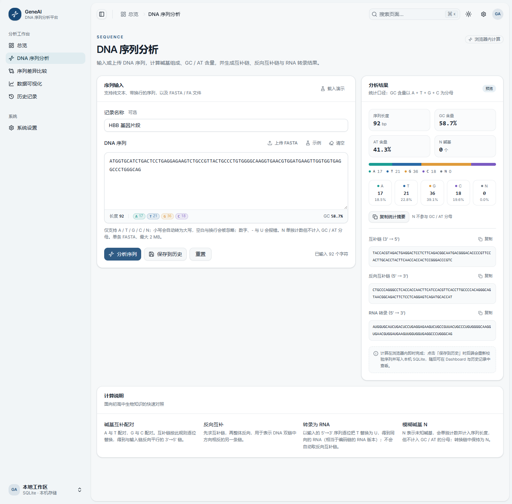

# GeneAI · DNA 智能序列分析与可视化平台

面向课程展示的 DNA 序列分析平台。输入或上传 DNA 序列，即可完成碱基组成、GC/AT 含量、互补链、反向互补链、RNA 转录与序列差异比较，并把分析结果保存在本机 SQLite 中。

前端基于 **shadcn-admin** 二次开发，保留下游的技术栈、组件体系与路由方案。



## 功能

| 模块           | 状态      | 说明                                                                          |
| -------------- | --------- | ----------------------------------------------------------------------------- |
| Dashboard 总览 | ✅        | 真实统计、碱基环形/柱状图、GC 趋势、最近记录与详情、快捷操作                  |
| DNA 序列分析   | ✅        | 手动/FASTA 输入、严格校验、A/T/G/C/N 统计、GC/AT、三条转换链、复制、保存历史  |
| 序列差异比较   | ✅        | Biopython 全局比对、替换/插入/缺失与参考坐标、对齐高亮、图例、保存比对记录    |
| 数据可视化     | ✅        | ECharts 环形/柱状/GC-AT 图、可配置滑动窗口曲线、长度分布，真实数据 + 演示标识 |
| 历史记录与报告 | 🚧 阶段 8 | 后端 CRUD 已就绪，列表页与 PDF 报告待完成                                     |
| 系统设置       | ✅        | 外观/主题、本地工作区信息（中文）                                             |

计算口径：GC = (G + C) / (A + T + G + C)，N 计入长度与计数但不进分母；RNA 为同向转录（逐位 T→U）。所有演示数据均明确标注「演示数据」，不会写入数据库。

## 技术栈

- 前端：React 19、Vite 8、TypeScript 6、Tailwind CSS 4、TanStack Router/Query/Table、shadcn/ui、ECharts、Lucide
- 后端：Python 3.12、FastAPI、SQLAlchemy 2、Biopython、SQLite
- 报告：ReportLab（阶段 8）

## 目录

```
├─ src/                 前端
│  ├─ features/         页面与业务组件（analysis / dashboard / settings …）
│  ├─ components/       ui 基础组件 + geneai 业务组件
│  ├─ lib/              dna.ts 算法、api 客户端、图表主题
│  ├─ routes/           TanStack Router 文件式路由
│  └─ styles/           theme.css 设计令牌
├─ server/              后端
│  ├─ app/
│  │  ├─ routers/       analyze / history / comparisons / stats
│  │  ├─ services/      dna.py、fasta.py、alignment.py
│  │  ├─ models.py      AnalysisRecord / Comparison / Meta
│  │  ├─ schemas.py     请求与响应模型
│  │  └─ main.py        FastAPI 入口
│  ├─ tests/            pytest（DNA + 比对 + API）
│  ├─ requirements.txt
│  └─ .env.example
├─ docs/screenshots/    各阶段验收截图
├─ API_DESIGN.md        接口说明
├─ DATABASE_DESIGN.md   数据库设计
└─ TEST_PLAN.md         测试计划
```

## 快速开始

### 1. 前端

```bash
pnpm install
pnpm dev --host 127.0.0.1 --port 5208
```

打开 http://127.0.0.1:5208 。Vite 已把 `/api` 代理到 `http://127.0.0.1:8000`。

### 2. 后端

需要 Python 3.12（3.14 下 Biopython 无预编译轮子，会触发源码编译）。

```bash
cd server
python -m venv .venv
.venv/Scripts/activate          # macOS/Linux: source .venv/bin/activate
pip install -r requirements.txt
cp .env.example .env            # 可选，按需修改端口/数据库路径
.venv/Scripts/python.exe -m uvicorn app.main:app --host 127.0.0.1 --port 8000
```

启动后访问 http://127.0.0.1:8000/docs 查看 OpenAPI 文档。首次启动自动建库 `server/geneai.db`。

### 3. 验证

```bash
# 前端
pnpm test:unit        # DNA 纯函数 29 个用例
pnpm build
pnpm lint

# 后端
cd server
.venv/Scripts/python.exe -m pytest tests -q   # 45 个用例（DNA/比对/API）
```

## 环境变量

后端读取 `server/.env`（不会覆盖真实环境变量），见 `server/.env.example`：

| 变量                   | 默认                    | 说明                   |
| ---------------------- | ----------------------- | ---------------------- |
| `GENEAI_DB_PATH`       | `server/geneai.db`      | SQLite 文件            |
| `DATABASE_URL`         | `sqlite:///…/geneai.db` | 完整连接串，优先级更高 |
| `MAX_SEQUENCE_LENGTH`  | `100000`                | 单条序列上限           |
| `MAX_UPLOAD_BYTES`     | `2097152`               | FASTA 上传上限         |
| `MAX_ALIGNMENT_LENGTH` | `5000`                  | 单条比对序列上限       |
| `CORS_ORIGIN_REGEX`    | localhost 任意端口      | 开发期跨域             |

前端可选 `VITE_API_BASE_URL`，默认同源 `/api`。

## API

阶段 6 已实现：

```
GET    /api/health
POST   /api/analyze
POST   /api/upload/fasta
POST   /api/history
GET    /api/history?q=&page=&page_size=
GET    /api/history/{id}
DELETE /api/history/{id}
GET    /api/history/{id}/gc-windows
GET    /api/stats/overview
POST   /api/compare
POST   /api/comparisons
GET    /api/comparisons?q=&page=&page_size=
GET    /api/comparisons/{id}
DELETE /api/comparisons/{id}
```

错误统一为 `{ detail, code, field? }`。详见 [API_DESIGN.md](API_DESIGN.md)。

## 说明

- 本项目不使用 AI 模型，所有 DNA 计算均由本地算法完成。
- 序列只保存在本机 SQLite，不上传第三方；日志不打印序列内容。
- 页面不提供疾病或临床结论，仅用于教学演示。

## 致谢

基于 [satnaing/shadcn-admin](https://github.com/satnaing/shadcn-admin) 二次开发，保留其 MIT License 与组件设计。
